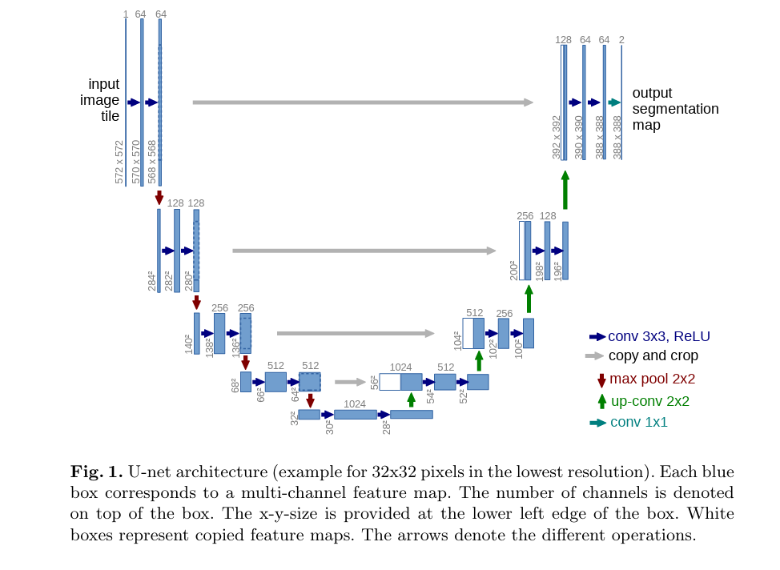

# Analysing HipMRI using 2D U-Net for Prostate Radiotherapy Planning

## How it works
U-Net is a type of convolutional neural network (CNN) developed to assist with biomedical imaging tasks. The encoder-decoder structure is useful for 2D images and isolating specific anatomical structures; in this case it is 2D MRI scans of hips that require radiotherapy for prostate tumours. Radiotherapy requires millimeter level precision so that tumours are accurately targeted and critical organs are spared. Specifically with 2D U-Net, under-contouring risks recoccuring tumours whilst over-conturing risks radiation toxicity. 

As the name suggests, the network architecture forms a 'U' shape consisting of a contracting path on the left and an expansive path on the right. The contracting path involves repeated application of two 3x3 unpadded convolutions.  This can be demonstrated in the below figure (Ronneberger et al., 2015). 

## Feasibility Review
### User Need, Scope & Acceptance Criteria
The intended user is medical specialists delivering radiotherapy to patients with tumours on their prostate. The purpose of this prototype is to assist medical specialists with predicting initial 2D prostate anatomical segmentations on HipMRI slice data. It will save time establishing a baseline model that evaluates boundary precision and spatial context trade-offs that can often occur in radiotherapy planning. Testable Criteria includes: Sørensen-Dice similarity coefficient (DSC) ≥0.75, GPU memory under 4GB VRAM, inference time <100ms per slice, prevent severe boundary leakage into adjacent Organs at Risk (rectal wall and bladder mucosa).
### Model Choice & Course Concepts
The proposed dataset configuration is the HipMRI 2D slice dataset (keras_slices_data) on the Rangpur HPC. They are Nifti images, meaning they will need to be loaded using the provided code. Model architecture will consist of 2D U-Net encoder-decoder featuring skip connections based on Ronneberger et al. (2015). The chosen difficulty band is easy, to align with my experience and confidence with machine learning. U-Net is a type of CNN, which are covered in the course and should be able to assist in the implementation. Additionally, Ronneberger et al. found that U-Net vastly outperforms sliding-window convolutional networks for biomedical imaging tasks.
### Preliminary Feasibility Evidence
A baseline smoke-test was run on my local machine with the downloaded images from rangpur with 3 epochs. The below results indicate that the images were successfully parsed and the model is learning and reducing loss with each epoch.
Epoch [1/3], Loss: 0.611606
Epoch [2/3], Loss: 0.459594
Epoch [3/3], Loss: 0.383542
### Risks, Budget & Fallback
Key risks include class imbalance causing model collapse, boundary leakage, and excessive wait time on the shared rangpur cluster. This task should be able to be completed well within 4GB of VRAM, utilising batch scripts for heavy tasks. The next steps will be verifying that the images can be parsed directly from the rangpur cluster rather than local downloads and using the full testing/training datasets rather than 20 slices. Then increasing epochs and training time to meet the required criteria through batch scripts in the rangpur cluster. Since this is classed as an easy task, I am confident that I should be able to come up with a feasible solution that can meet my criteria. If the queue on the shared rangpur cluster becomes too long, I will utilise Google’s GPU plans. 

## Dependencies
All code files were written in python 3.11. The images used to train this model are 2D medical nifti files, hence the following python libraries were used for data loading: numpy, nibabel and tqdm. Furthermore, the model was built and trained using pytorch.

The results are able to be reproduced provided the user has an appropriate GPU for the task and access to keras_slices_data datasets.

• Example inputs, outputs, and visual plots of your algorithm.

## Data Pre-Processing
The data was already split into training, testing and validation sets so this was not necessary. However, the provided images were nifty files, so provided code was utilised to process these images. For ease of processing, 60 images were excluded as they were a different shape from the other ~1400. Additionally, data was split and trained by patient. 

## Open Research Investigation
– Quantitative benchmarking of your chosen model against your implemented baseline model under
identical evaluation splits.
– Resource profiling table documenting computational efficiency (peak GPU VRAM, parameter
count, and inference runtime/latency).
– In-depth qualitative error autopsies analyzing 3–5 representative failure cases from the dataset
(diagnosing root triggers and failure modes).
– Actionable engineering recommendation and trade-off synthesis for your project manager.

## AI Disclosure 
Anthropic Claude was utilised for the development of this solution. 