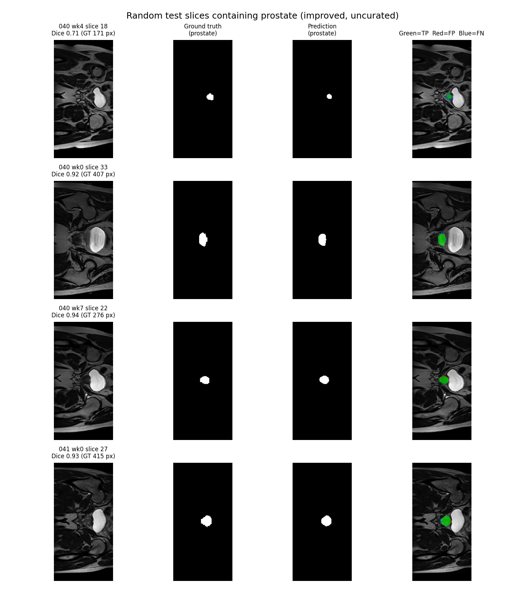
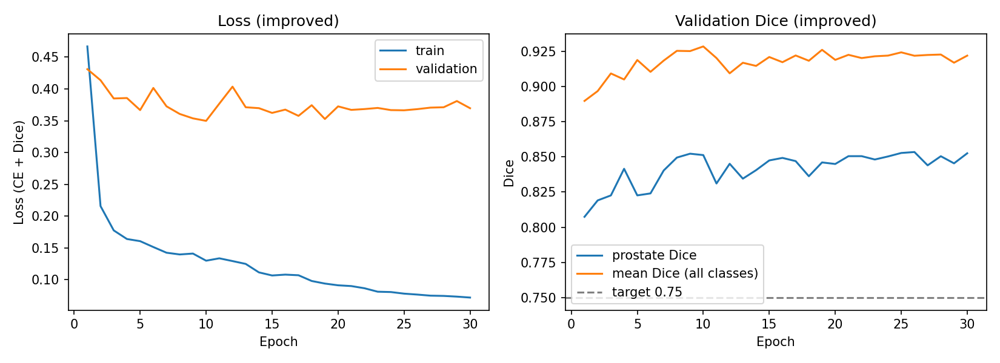
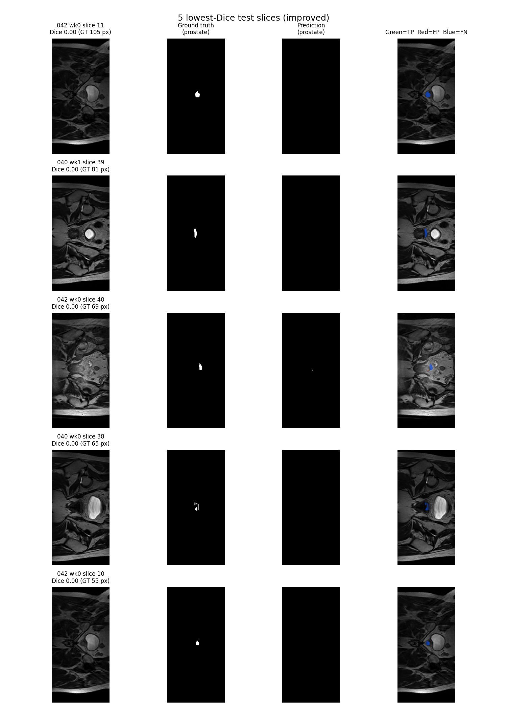

# Analysing HipMRI using 2D U-Net for Prostate Radiotherapy Planning

## How it works
U-Net is a type of convolutional neural network (CNN) developed to assist with biomedical imaging tasks. The encoder-decoder structure is useful for 2D images and isolating specific anatomical structures; in this case it is 2D MRI scans of hips that require radiotherapy for prostate tumours. Radiotherapy requires millimeter level precision so that tumours are accurately targeted and critical organs are spared. Specifically with 2D U-Net, under-contouring risks recoccuring tumours whilst over-conturing risks radiation toxicity. 

As the name suggests, the network architecture forms a 'U' shape consisting of a contracting path on the left and an expansive path on the right. The contracting path involves repeated application of two 3x3 unpadded convolutions, followed by a rectified linear unit (ReLU) and a 2x2 max pooling operation with stride 2 for downsampling. The number of feature channels are doubled at each downsampling step. For the expanding path, there is an upsampling of the feature map followed by a 2x2 convolution that halves the number of feature channels, a concatenation with the correspondingly cropped feature map from the contracting path, and two 3x3 convolutions, each followed by a ReLU. Finally, a 1x1 convulution maps each 64-component feature vector to the desired number of classes. This can be demonstrated in the below figure (Ronneberger et al., 2015). The network is trained with input images and their corresponding segmentation maps.

## Feasibility Review
### User Need, Scope & Acceptance Criteria
The intended user is medical specialists delivering radiotherapy to patients with tumours on their prostate. The purpose of this prototype is to assist medical specialists with predicting initial 2D prostate anatomical segmentations on HipMRI slice data. It will save time establishing a baseline model that evaluates boundary precision and spatial context trade-offs that can often occur in radiotherapy planning. 
Testable Criteria includes: 
1. Sørensen-Dice similarity coefficient (DSC) ≥0.75
2. GPU memory under 4GB VRAM
3. Inference time <100ms per slice
4. Prevent severe boundary leakage into adjacent Organs at Risk (rectal wall and bladder mucosa).
### Model Choice & Course Concepts
The proposed dataset configuration is the HipMRI 2D slice dataset (keras_slices_data) on the Rangpur HPC. They are Nifti images, meaning they will need to be loaded using the provided code. Model architecture will consist of 2D U-Net encoder-decoder featuring skip connections based on Ronneberger et al. (2015). The chosen difficulty band is easy, to align with my experience and confidence with machine learning. U-Net is a type of CNN, which are covered in the course and should be able to assist in the implementation. Additionally, Ronneberger et al. found that U-Net vastly outperforms sliding-window convolutional networks for biomedical imaging tasks.
### Preliminary Feasibility Evidence
Initial baseline testing was conducted by locally downloading the dataset files and training with 3 epochs to verify the data could be loaded and processed correctly. This was then conducted on the rangpur cluster to verify feasability with submitting job scripts. Once I was confident, I moved onto larger training to verify the model was reducing loss and learning effectively.
### Risks, Budget & Fallback
Key risks include class imbalance causing model collapse, boundary leakage, and excessive wait time on the shared rangpur cluster. This task should be able to be completed well within 4GB of VRAM, utilising batch scripts for heavy tasks. The next steps will be verifying that the images can be parsed directly from the rangpur cluster rather than local downloads and using the full testing/training datasets rather than 20 slices. Then increasing epochs and training time to meet the required criteria through batch scripts in the rangpur cluster. Since this is classed as an easy task, I am confident that I should be able to come up with a feasible solution that can meet my criteria. If the queue on the shared rangpur cluster becomes too long Google has affordable GPU plans to meet computing needs. 

## Dependencies
All code was written in Python 3.11.16. Training and evaluation used the following libraries:

| Library | Version | Used for |
|---|---|---|
| torch | 2.13.0 | Model (`modules.py`), (`train.py`) training and evaluation |
| torchvision | 0.28.0 | Model (`modules.py`), (`train.py`) training and evaluation |
| NumPy | 2.4.6 | Array handling in data loading and analysis |
| nibabel | 5.4.2 | Reading the 2D NIfTI slices |
| tqdm | 4.70.1 | Progress bars while loading data |
| matplotlib | 3.11.2 | Training curves and prediction figures |

To reproduce the results you need access to the `keras_slices_data` dataset (the HipMRI 2D slices). Models were trained on a single NVIDIA A100 on the UQ Rangpur cluster (~21 min for 30 epochs); the code also runs on CPU but is much slower.

## Plots
The figure below contains five randomly selected slices from the dataset and displays the original image, prostate ground truth, prostate prediction, as well as true positives and false negatives/postives.

The below plots show how loss and dice change with each epoch as the model trains. 

## Data Pre-Processing
The data was already split into training, testing and validation sets so further splitting was not necessary. However, the provided images were nIfTI files, so provided code (nifti.py) was utilised to load the images. One-hot encoding was used for the six channels(background, body, bone, bladder, rectum, prostate). 

For ease of processing, 60 images with shape 256×144 were excluded and the remaining 11,400 images with shape 256×128 were used for training and testing. The provided split was checked for patient-level leakage using the patient ID such that no patient appears across multiple split. Training used horizontal and vertical flip augmentation.

## Open Research Investigation
### Quantitative Benchmarking
The training and inference of the initial model can be found in initial_train_outputs/ and initial_predict_outputs/ respectively. Whilst this model performed quite well against the elected testable criteria, I wanted to try and reduce over-segmentation and bladder leakage by manipulating the prostate weight. 

| Metric                | Baseline             | Improved             |
| -----------           | -----------          | -----------          |
| Global Volumetric DSC | 0.8828               | 0.8737               |
| Global Volumetric IoU | 0.7901               | 0.7757               |
| False Positive Pixels | 7,348 px             | 6,840 px             |
| False Negative Pixels | 6,794 px             | 8,160 px             |
| Bladder Leakage       | 268 px               | 229 px               |
| Rectum Leakage        | 9 px                 | 44 px                |

The improved run sligtly reduced the DSC and IoU, so it could be considered worse. However, both models produced well above acceptable values. Whilst the improved model managed to reduce over-segmentation and create less false positives, it increased under-segmentation and ended up creating more false negatives. Furthermore, it reduced bladder leakage slightly, but also increased rectum leakage slightly. Both leakage values are quite small already, so I don't think it is problematic. 

### Resource Profiling
| Resource          | Metric               |
| -----------       | -----------          |
| Peak GPU VRAM     | 2992.30 MB           |
| Parameters        | 17,262,150           |
| Inference Latency | 2.97ms/slice         |
| Training Time     | 21 min for 30 epochs |

### Failure Cases
The figure below includes five slices with the lowest Dice score. All 5 have a dice score of 0.00 and predicted almost nothing (4/5 predicted 0 pixels), causing them all to produce false negatives. All 5 failure cases occur at the organ boundaries. This could mean that the model is too conservative and is therefore missing these boundary slices.

3 of the failure cases are from patient 42 week 0, and in particular consecutive weeks 10 and 11 are included. This is because this patient has significant under-segmentation for its lower bounds and could explain why the mean slice dice was only 0.69 for that patient. 

### Actionable Recommendations/Trade-offs
The current model is an appropriate benchmark, with DSC well above the 0.75 target and has minimal boundary leakage into the bladder and rectum. It also only takes around 20 minutes to train and about 3GB of GPU making it a reltively cost-effective an time-saving solution for radiotherapy planning. 

It is advised that the first last few slices of the prostate are unsuitable for automated drafting as the model predicts zero pixels. An effective mitigation would be flagging slices with empty or very miniscule predictions for manual review. 

Experimentation with seed, augmentation and class weighting did not produce improved results, but a wider dataset with more patients may be worth looking into to produce a more effective model. 

## AI Disclosure 
Anthropic Claude was utilised for the development of this solution. It assisted with scaffolding data loading scripts, particularly as I was unfamiliar with Nifti files. Additionally, it helped siggest improvements to my training and predicting scripts once I had an initial working solution. 

Every piece of AI code was read over, and useful parts were integrated into scripts. It was verified locally with minor 'smoke tests'. All results and output were manually and thoroughly examined to ensure AI did not hallucinate outcomes. 